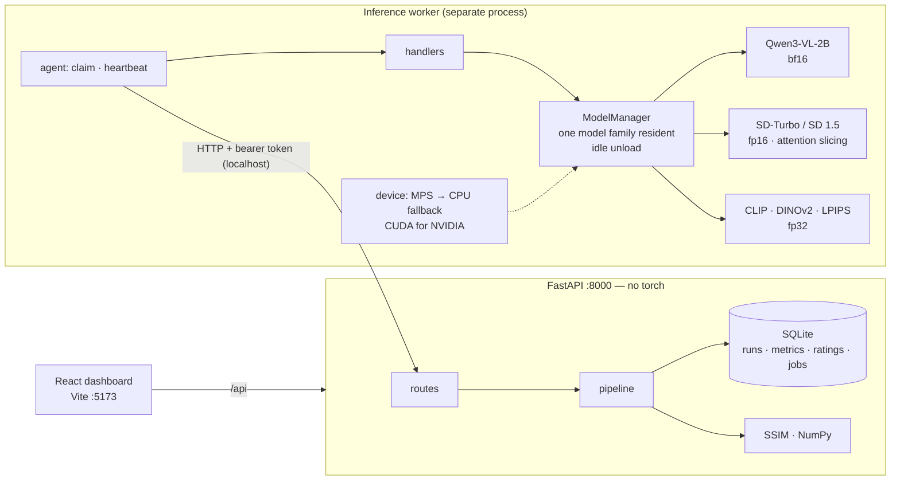

# PE — Image-to-Prompt Reconstruction Research Platform

Reverse-engineer a text prompt that makes a diffusion model regenerate a reference image, and
measure — honestly — how close each stage gets.

## Research objective

Does a **structured, reconstructed prompt** (and iterative refinement of it) reproduce a reference image more
faithfully than an **ordinary image caption**, when everything except the prompt is held fixed?

| Condition | Prompt |
|---|---|
| **A** · Caption | the VLM's one-sentence caption, verbatim |
| **D** · Detailed prose | the structured attributes rendered as sentences (`natural_v1`) |
| **B** · Structured | the structured attributes → fixed tag template → rule-validated (`structured_v1`) |
| **C** · Refined | an iterative refinement loop started from B (reported as the **final** iteration) |

A, D and B are generated with the same model, seed, steps, guidance and resolution — only the prompt differs.

### Existing findings — read before interpreting anything

* **Earlier 12-image pilot (researcher-reported; raw data not in this repository):** structured prompts did
  **not** consistently outperform plain captions, and the apparent refinement improvements were potentially
  affected by **selection bias** (choosing the best iteration after the fact).
* This repository contains **no stored experimental results**; the dashboard shows only what is measured on the
  machine it runs on. Nothing is simulated or back-filled.

The dashboard labels every statement as *measured*, *human evaluation*, *model/rule suggestion*, *hypothesis*,
*future work* or *reported prior finding*.

## Pipeline

```
reference image ─▶ 1 ANALYZE (Qwen3-VL-2B) ─▶ 2 STRUCTURE (templates + validation) ─▶ 3 GENERATE (SD-Turbo / SD 1.5)
                                                        ▲                                       │
                                                        └── 5 REFINE (rule proposals, human ◀── 4 COMPARE (CLIP · DINOv2 ·
                                                             approve/reject, early stop)          SSIM · LPIPS · human ratings)
```

## Architecture (Apple Silicon, single machine)



* The API never imports torch; all model work is a **job** executed by the worker. On this Mac the worker runs
  locally (`scripts/dev.sh` starts it); the same worker code runs on an NVIDIA machine (CUDA) unchanged.
* **Sequential model loading** for 16 GB unified memory: at most one heavy family (VLM *or* diffusion *or*
  metrics) is resident; switching family unloads and releases the MPS cache; idle models unload after 5 min.
* Memory is measured as the macOS **physical footprint** of the worker (includes Metal/MPS buffers) and reported
  live on the Overview page and in every run's runtime info.

More: [docs/ARCHITECTURE.md](docs/ARCHITECTURE.md) · Apple Silicon details, measured memory and troubleshooting:
[docs/APPLE_SILICON.md](docs/APPLE_SILICON.md).

## Models

| Stage | Model | Precision on MPS | Notes |
|---|---|---|---|
| Analyze | `Qwen/Qwen3-VL-2B-Instruct` | bfloat16 | greedy decoding; image downscaled to ≤ 768 px (configurable) |
| Generate | `stabilityai/sd-turbo` (default) | float16 | 1–4 steps, no CFG, 512×512 |
| Generate | `stable-diffusion-v1-5/stable-diffusion-v1-5` | float16 | 25–30 steps, CFG 7.5, 512×512 |
| Generate | `stabilityai/stable-diffusion-xl-base-1.0` | — | registered, **not recommended / not verified on 16 GB** |
| Evaluate | CLIP ViT-L/14 · CLIP ViT-B/32 · DINOv2-base · LPIPS-AlexNet | float32 | CPU fallback if an MPS kernel fails (recorded) |
| Evaluate | SSIM | NumPy | runs in the API process |

## Evaluation methodology

| Metric | Direction | Measures |
|---|---|---|
| CLIP ViT-L/14 cosine | ↑ higher = closer | semantic content |
| DINOv2 cosine | ↑ higher = closer | object identity / structure |
| SSIM (luma, Gaussian window) | ↑ higher = closer | aligned pixels; strict — any layout change lowers it |
| LPIPS (AlexNet) | ↓ **lower** = closer | learned perceptual distance |
| Human rating 1–5 (optional blind) | ↑ | stored separately, never mixed into metrics |

* **Optimisation ≠ evaluation.** Refinement optimises CLIP ViT-B/32; it is judged with the other metrics.
* **No selection bias in reporting.** Refinement is reported as *iteration 0*, *final* and *best*; *best* is
  flagged as selection-biased and is never presented as "the refinement result".
* **Paired comparisons** count wins/losses/ties per metric only between runs of the same reference with identical
  settings, not just means.
* Every run records reference SHA-256, prompt lineage, model id, seed/steps/CFG/size, device, dtype, generator
  device, package versions, timing, peak memory and a code fingerprint (git commit + source hash).

## Installation on Apple Silicon (macOS, arm64)

Requirements: [uv](https://docs.astral.sh/uv/), Node.js LTS, ~12 GB free disk for model weights. The system
Python is not used or modified.

```bash
curl -LsSf https://astral.sh/uv/install.sh | sh        # if uv is missing
# Node.js LTS: https://nodejs.org (or `brew install node`)

git clone https://github.com/Greninja44/PE.git ~/Projects/PE
cd ~/Projects/PE
scripts/setup_mac.sh                                    # Python 3.12 venv, MPS PyTorch, npm deps, backend/.env, MPS self-test
backend/.venv/bin/python scripts/download_models.py     # ~9 GB, once (resumable; see --list / --only)
```

## Running

```bash
scripts/dev.sh                    # API :8000 + local inference worker (MPS) + dashboard :5173
PE_API_PORT=8010 scripts/dev.sh   # if port 8000 is taken (e.g. by Docker)
```

Open <http://localhost:5173>. API docs: <http://localhost:8000/docs>. Ctrl+C stops all three.

Components separately (three terminals):

```bash
cd backend && .venv/bin/uvicorn app.main:app --port 8000
cd backend && .venv/bin/python -m app.workers.agent local       # auto-registers with PE_ADMIN_TOKEN from .env
cd frontend && npx vite --port 5173
```

Checks:

```bash
backend/.venv/bin/python -m app.workers.agent doctor                         # real tensor ops on MPS
backend/.venv/bin/python scripts/verify_inference.py --image photo.jpg       # every model, real inference, timed
scripts/test.sh                                                              # backend tests + frontend build
```

## Running an experiment

1. **New Reconstruction** — upload the reference image (optionally attach it to an Experiment).
2. **1 · Image Analysis** — run Qwen3-VL in *caption* mode and in *structured* mode; inspect both.
3. **2 · Prompt Studio** — build prompts from the structured analysis; inspect validation issues; edit if desired
   (edits become new immutable versions).
4. **3 · Image Generation** — *Controlled comparison*: pick the caption (A), detailed (D — click *Create*) and
   structured (B) prompts and run them with identical settings.
5. **4 · Evaluation** — metrics are queued automatically for every generated image.
6. **5 · Refinement** — start a session from B; approve/reject rule-based proposals; the loop stops early.
7. **Compare & Rate** — all runs side by side with metric directions, prompt length, time and iteration count;
   rate images blind (1–5).
8. **Research Findings** — aggregates, paired win/loss counts, human ratings. **Experiments** — export JSON/CSV
   and write-once reports. **Presentation Mode** (`/present`) for demonstrations.

## Fine-tuning (LoRA on SD 1.5)

LoRA adapters for the SD 1.5 UNet trained on a filtered, CC0 DiffusionDB subset with a prompt-grouped split; trained
adapters are selectable for SD 1.5 generation and evaluated against the base model on held-out test prompts. Method,
data, measured training runs and limits: [docs/FINETUNING.md](docs/FINETUNING.md). Dashboard: **Fine-tuning (LoRA)**.

## Configuration (`backend/.env`, see `.env.example`)

`PE_DEVICE` (auto|mps|cuda|cpu) · `PE_HALF_PRECISION` · `PE_VLM_MAX_IMAGE_SIDE` · `PE_ATTENTION_SLICING` ·
`PE_WORKER_IDLE_UNLOAD_S` · `PE_STRICT_MEMORY_CHECK` · `PE_ADMIN_TOKEN` · `PE_DATABASE_URL` ·
`PE_EXPERIMENTS_DIR` · optional `PE_OPENAI_COMPAT_*` / `PE_HF_TOKEN` remote providers.

## Integrity rules (enforced in code)

* **No simulated outputs.** Unconfigured providers are refused (HTTP 422). Jobs stay *queued* until a real worker
  executes them. A metric that has not run has `value = null` and a status — never a number. NaN scores and
  all-black (half-precision NaN) images are rejected as failures, not stored.
* **Never overwrite reports.** Reports use exclusive file creation with timestamped names.
* **Test fixtures stay in tests.** Synthetic gradient images and hand-picked scores exist only in `backend/tests/`.

## Limitations

* 16 GB unified memory: models run one family at a time; SDXL and Qwen3-VL-4B are not recommended.
* MPS results are reproducible per device for a fixed seed, but not bit-identical to CUDA results.
* The first load of each model is slow (disk → memory); subsequent runs reuse it until idle unload.
* The refinement proposer is rule-based and depends on the VLM's (fallible) description of generated images.
* CLIP token counts in the UI are approximate. SQLite + additive in-place migrations (no Alembic).
* The dashboard has no authentication — run it on localhost or a trusted network.

## Future work

Larger pre-registered image sets with several seeds; paired statistical tests; multiple blind raters with
agreement statistics; quantised VLM inference (e.g. MLX) on Apple Silicon once it supports the needed model and
offers a measured advantage; SDXL on machines with more memory.

## Other platforms

* **Windows (NVIDIA or CPU):** [docs/WINDOWS_SETUP.md](docs/WINDOWS_SETUP.md) — `scripts\setup_windows.ps1`,
  `scripts\dev.ps1`, `scripts\test.ps1`.
* **CPU-only / Codespaces:** `scripts/setup_cloud.sh`, then `PE_NO_WORKER=1 scripts/dev.sh`.
* **NVIDIA GPU worker (RTX 5060 etc.):** [docs/RTX5060_SETUP.md](docs/RTX5060_SETUP.md) — unchanged; CUDA is
  selected automatically when present.

## Repository layout

```
backend/app/
  runtime/        device selection (MPS/CUDA/CPU), memory diagnostics, model lifecycle   ← new
  analysis/       Stage 1 — VLM providers (Qwen3-VL local runner, OpenAI-compatible, HF router)
  prompt_engine/  Stage 2 — attribute schema, fixed templates, validator
  generation/     Stage 3 — model registry, diffusers runner, HF inference provider
  evaluation/     Stage 4 — CLIP, DINOv2, SSIM (NumPy), LPIPS
  refinement/     Stage 5 — rule-based proposer, stopping policy, session state machine
  experiments/    tracking, comparison & paired statistics, exports, write-once reports, demo bundles
  workers/        job queue (leases/retries/resume), worker agent (local / remote), handlers
  services/ api/ database/ config/
frontend/src/     React + TypeScript + Tailwind + Recharts (12 pages incl. Compare & Rate, Presentation Mode)
scripts/          setup_mac.sh · dev.sh · download_models.py · verify_inference.py · test.sh · setup_cloud.sh · GPU worker setup
docs/             APPLE_SILICON.md · MACOS_MIGRATION_AUDIT.md · ARCHITECTURE.md · RTX5060_SETUP.md · RECOVERY_AUDIT.md
experiments/      originals/ generated/ (media, git-ignored) · prompts/ metrics/ reports/ demo/ (tracked)
```
