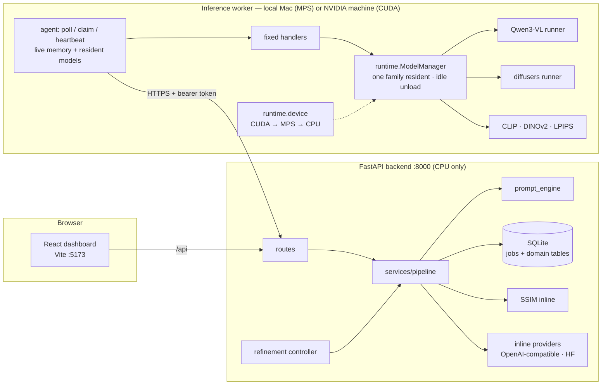
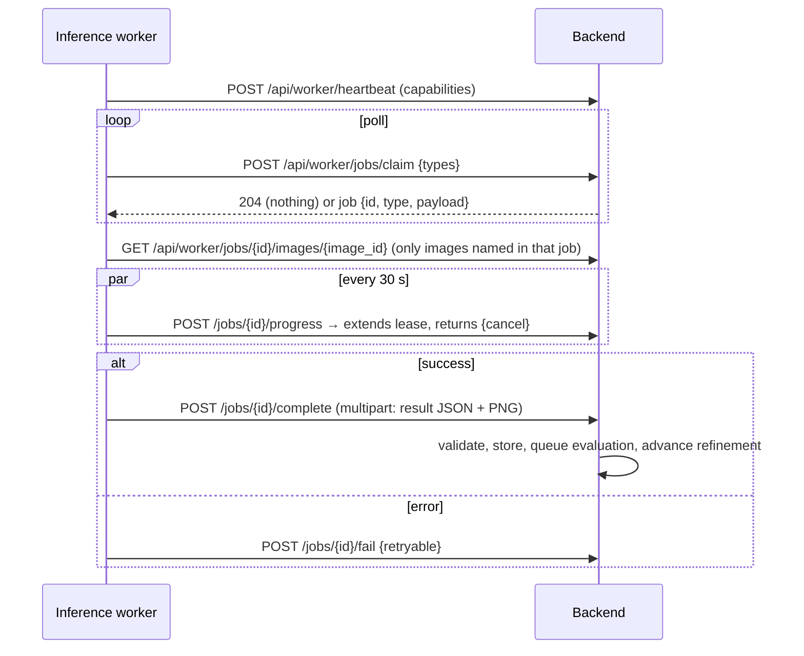

# Architecture

## Components

The API process never imports torch. Everything that needs a model becomes a **job**. On Apple Silicon the worker
runs on the same machine (`python -m app.workers.agent local`, started by `scripts/dev.sh`), which keeps model memory
in a process that can be restarted independently of the API.

## Data model

| Table | Purpose |
|---|---|
| `images` | Content-addressed (SHA-256) originals and generated outputs; files live under `experiments/` |
| `reconstructions` | One reference image under study; optionally linked to an `experiment` |
| `analyses` | Stage 1 output (`structured` JSON or `caption`), provider, model, raw output, status, error, runtime info |
| `prompt_versions` | Immutable, numbered versions with `parent_id` lineage and `source` (caption / structured / validated / edited / manual / refinement) |
| `generation_runs` | Stage 3 run: prompt version, model, full params incl. seed, condition label (A/B/C), runtime info, output image |
| `metric_results` | One row per metric per generation; `role` = optimization / evaluation; `value` NULL unless completed |
| `refinement_sessions` / `refinement_iterations` | Loop configuration, best iteration, stop reason; per-iteration proposal, decision, score |
| `experiments` | Name, hypothesis, config, code fingerprint at creation |
| `human_ratings` | Human 1–5 similarity (+ optional subject/style), rater, blind flag, notes — separate from `metric_results` |
| `jobs` / `workers` | Queue with leases; workers authenticate with hashed bearer tokens |

## Execution model

| Work | Where | How |
|---|---|---|
| Prompt building & validation | API | synchronous, pure Python |
| SSIM | API | background task (NumPy) |
| OpenAI-compatible / HF VLM, HF image generation | API | background task over HTTP |
| Qwen3-VL, diffusers, CLIP, DINOv2, LPIPS | GPU worker | queued job |

Row status moves `pending/queued → running → completed | failed | unavailable`. Job failures propagate to the domain
rows so the UI never shows a stale "queued".

## Job queue and worker protocol

* **Leases & resume.** A claim sets `lease_expires_at = now + 300 s`; heartbeats extend it. If the laptop sleeps or
  the agent crashes, the next claim re-queues expired jobs (until `max_attempts`, default 3). Generation is seeded,
  so a re-run reproduces the same image.
* **Atomic claim.** `UPDATE … WHERE status='queued'` compare-and-set; two workers can never take the same job.
* **Security.** Payloads are typed (`extra="forbid"`), job types map to a fixed handler table, models must be in an
  allow-list, `trust_remote_code=False`, no payload field is ever used as a shell command, path or URL. Worker tokens
  are stored as SHA-256 hashes; registration requires `PE_ADMIN_TOKEN`. Uploaded results are re-validated (image
  decodes, size matches the requested resolution, completed metrics carry values).
* **Memory.** The worker keeps at most one heavy model family resident (VLM *or* diffusion *or* metric models) so it
  fits in 16 GB unified memory (Apple Silicon) or 8 GB VRAM; idle models are unloaded after `PE_WORKER_IDLE_UNLOAD_S`;
  each unload releases the MPS/CUDA allocator cache. A pre-load check compares free memory with the model's
  documented size (warn by default, refuse with `PE_STRICT_MEMORY_CHECK`). SDXL uses model CPU offload on CUDA
  below 12 GB. Each job records the measured peak worker footprint.
* **Devices.** `runtime.device` selects CUDA → MPS → CPU (`PE_DEVICE` to force), sets
  `PYTORCH_ENABLE_MPS_FALLBACK=1` before torch is imported, and fixes precision per family (VLM bf16, diffusion
  fp16, metrics fp32; CPU fp32 except bf16 VLM). Metrics that raise on MPS are recomputed on CPU and the fallback is
  recorded in the metric's detail.

## Prompt engine

1. **Templates** (`structured_v1`, `subject_first_v1`, `natural_v1`, `caption_v1`) map attributes to ordered segments.
2. **Validator** — rule-based and explainable:
   * contradictions from scoped exclusive term groups (time of day, lighting key, colour mode, medium, shot scale,
     vertical angle, indoor/outdoor, depth of field, season) and positive/negative overlap;
   * exact and near-duplicate phrases (Jaccard ≥ 0.8 over singularised tokens), within lists and across segments;
   * relationships: incomplete, self-referential, unknown entities, non-canonical predicates, opposite or
     contradictory asymmetric relations (A left of B ∧ A right of B; A behind B ∧ B behind A);
   * approximate CLIP-window overflow (77 tokens).
3. **Safe fixes only** — exact duplicates, invalid relations and negative terms that conflict with the positive
   prompt. Real contradictions are left for a human. Both the original and validated versions are stored.

## Refinement loop

* Iteration 0 = baseline (the chosen prompt version). Each generation is scored with the optimisation metric
  (`role=optimization`) and, separately, the evaluation set.
* `rules_v1` proposer compares the reference analysis with a VLM analysis of the current best output: missing
  objects/colours, hallucinated objects (→ negative), medium mismatch, lighting/camera/composition/background drift,
  plus structural rules (restore empty fields, CLIP-window overflow). It proposes at most *k* edits with reasons and
  never re-proposes rejected or already-tried edits.
* The user approves (all or a subset) or rejects. Approval creates a `refinement` prompt version from the **best**
  prompt (hill climbing) and queues generation.
* `policy.decide()` tracks the best score (respecting `higher_is_better`), stops early after `patience` iterations
  without an improvement > `min_delta`, or at `max_iterations`. Failed iterations count toward the budget.

## Comparison and reporting

`experiments/comparison.py` builds (a) a per-reference table of **every** generation — condition, refinement view,
prompt length, settings key, device, time, peak memory, evaluation metrics and human-rating summary — and (b) an
aggregate over all (or one experiment's) references: per-group mean/SD/n, and paired win/loss/tie counts restricted
to identical settings. Refinement views overlap and are labelled; `C_refined_best` carries `selection_biased: true`.
Presentation Mode and demo bundles show the *final* refinement iteration for condition C.

## Experiment tracking

* `code_fingerprint()` — git commit, dirty flag, SHA-256 over `backend/app/**/*.py`, Python and package versions.
* Export: `/api/experiments/{id}/export.json` (nested, schema `pe.experiment.v1`) and `export.csv` (long format, one
  row per generation × metric; pending metrics are empty cells).
* `POST /api/experiments/{id}/reports` writes `experiments/reports/<UTC stamp>_<slug>_<id>.json|csv` plus prompt and
  metric snapshots in `experiments/prompts/` and `experiments/metrics/`, using `open(..., "x")` so nothing is
  overwritten.
* Demo bundles (`experiments/demo/<stamp>_<slug>_<id>/manifest.json` + JPEG thumbnails) are small, git-trackable
  snapshots of a genuine A/B/C comparison for Presentation Mode.

## Testing

`backend/tests/` (66 tests; inference mocked): prompt engine rules, SSIM properties and closed-form check, parsing of VLM output,
OpenAI-compatible request shape, the full API flow with a simulated worker (auth, image scoping, wrong-size upload
rejection, retries, lease-expiry resume, cancellation), refinement approve/reject/early-stop, experiment export and
write-once reports, the real worker agent code against the API with a stub handler, device selection and
fallbacks, model lifecycle (sequential loading, idle unload, memory refusal), mocked handlers, NaN/black-image
rejection, the A/D/B comparison with paired statistics, refinement views (iteration 0 / final / best), human ratings
and the additive SQLite migration. Real-model checks are in `scripts/verify_inference.py`. SSIM was additionally
cross-checked against scikit-image (difference ≤ 1e-16). Synthetic gradient images and hand-picked scores are used
only inside tests.

## Known limitations

* SQLite + `create_all` (no Alembic migrations yet); fine for a single-lab deployment.
* The dashboard itself has no authentication — run it on localhost or a trusted network.
* CLIP token counts in the UI are approximate.
* Hosted inference providers do not guarantee seed handling and are flagged non-reproducible.
